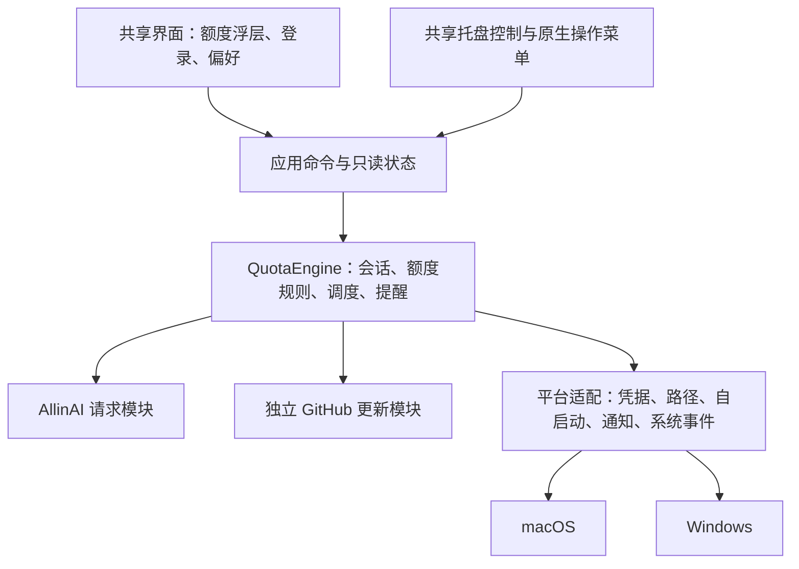

# macOS / Windows 单仓与共享源码方案

2026-10-20 · 历史选型记录，方案未采用。

**最终决定：继续独立仓库、原生维护。** 用户评估后决定保留 Swift / AppKit 与 C# / WinForms；Windows 已按 macOS 0.2.0 基线同步业务功能。后续工作以[原生版本同步约定](../NATIVE_PARITY.md)为准。本页正文保留选型时 Windows 0.1.0 的差异分析，不代表当前 Windows 版本仍有这些缺口，也不构成迁移计划。

**建议先明确目标：统一维护业务规则和界面，而不是追求两个系统完全没有不同代码。** 按“以后改功能尽量只改一次”的目标，我倾向于 Tauri 2 + Rust + 简单 Web 界面；如果维护者主要熟悉 C#，Avalonia 是值得优先考虑的另一条统一路线。保留 Swift / WinForms，再加入共享核心，最有利于保留现有界面，但对这个小项目未必能降低总体维护成本。

本次只检查源码和框架文档，没有替换应用、合并远端仓库或进行跨平台运行验证。性能、安装体验和系统集成仍需原型验证。

**目前两份代码已经分叉**

检查基线：

- macOS：本仓库 `79e417d`，版本 0.2.0，`Sources/AllinAIQuotaMenu.swift` 共 1,872 行，另有回归测试。
- Windows：[仓库源码 e788797](https://github.com/qx0657/allinai-quota-tray-windows/blob/e788797932f9c6570c071add68ae4a7eda98bfc4/Program.cs)，版本 0.1.0，`Program.cs` 共 1,289 行，使用 .NET 8 / WinForms。检查到的仓库没有独立测试工程。

| 行为 | macOS 当前实现 | Windows 当前实现 |
| --- | --- | --- |
| 主额度周期 | 选择已知周期中最受限的一个 | 优先第一个有效限额：每日、每周、每月 |
| 图标含义 | 表示剩余比例 | 表示已用比例 |
| 过期订阅与余额 | 没有有效订阅时可以进入余额模式 | 无 active 订阅时仍可能选择第一条过期记录 |
| 缺失用量 | 明确表示未知 | `BestMetric` 将缺失用量补为 0 |
| 请求失败 | 订阅、余额分别保留最近成功数据 | 刷新失败切换错误状态；余额请求异常被吞掉并返回空值 |
| 登录恢复 | 区分认证错误、离线、服务异常和限流 | 较宽泛地捕获异常后重新登录 |
| 调度 | 退避、冷却、睡眠暂停、唤醒和网络恢复 | 定时刷新与避免重复执行 |
| 后续功能 | 提醒、更新检查、多订阅选择等 | 尚未包含这些功能 |

例如每日剩余 80%、每周剩余 10%，两端目前会选择不同的主周期。只合并仓库并不能消除这类差异。

迁移时以 macOS 0.2.0 的已确定行为和现有测试为基线。它仍有需要确认的后端语义，例如缺失限额、周期重置与额度耗尽后的扣费方式；共享实现不能把这些未知事项自行解释为零、无限或自动扣余额。

**四种路线的真实取舍**

| 路线 | 共享范围 | 初期工作 | 后续维护 | 现有体验 |
| --- | --- | --- | --- | --- |
| A. 单仓放 Swift 与 C# | 文档、版本、发布流程；业务仍两份 | 最少 | 仍需同步功能和修复 | 最容易保留 |
| B. Rust 核心 + Swift / WinForms | 业务、请求、状态与测试 | 提取核心并接两套跨语言接口 | 核心改一次；还维护三种语言、两套 UI 和绑定 | 最容易保留当前原生界面 |
| C. Tauri 2 统一应用 | Rust 业务、托盘控制、Web 界面 | 重写业务与展示，搬运既有测试 | 功能集中；平台差异局限于适配与打包 | 托盘和操作菜单可原生；富信息区需要重做 |
| D. Avalonia 统一应用 | C# 业务、XAML 界面 | 可复用部分 C#；重做 UI、补齐 macOS 行为 | 主要维护 C# / XAML，另有平台适配 | 提供系统集成，但不等于复用现有 AppKit 视图 |

这是一项工程判断，不是性能排名。没有原型前，不给出内存、包体、复用比例或精确工期承诺。

A 适合作为迁移过程中的过渡。B 的价值在于“保留已经满意的原生界面”，不是“源码和构建最少”。它需要处理 Swift / C# 调 Rust 时的 ABI、对象和字符串释放、异步回调、UI 线程调度、取消与动态库打包。选择 Go 等共享核心也不能消除这类宿主集成工作。

C 的优势是托盘、菜单和应用打包已有框架支持；后台业务留在 Rust，前端只负责展示与输入。Tauri 使用系统 WebView，Windows 仍需 WebView2，安装包需要处理其缺失情况；不能理解成没有运行时依赖或性能等同于现有 Swift 应用。[Tauri 架构](https://v2.tauri.app/concept/architecture/)、[Windows 安装说明](https://v2.tauri.app/distribute/windows-installer/#webview2-installation-options)。

D 对熟悉 C# 的维护者很有吸引力。Avalonia 提供 macOS 托盘、原生菜单和隐藏 Dock 图标的能力，也支持 Windows 托盘菜单；它使用自己的跨平台 UI 与 macOS 后端，现有 WinForms 控件和 AppKit 自定义视图不能直接照搬。应比较实际发布产物、运行时部署和内存，再判断是否适合这个常驻工具。[macOS 平台说明](https://docs.avaloniaui.net/docs/platform-specific-guides/macos)、[Windows 平台说明](https://docs.avaloniaui.net/docs/platform-specific-guides/windows/)、[NativeMenu](https://docs.avaloniaui.net/controls/menus/nativemenu)。

不把 Electron、Flutter 等加入首轮原型，主要是控制选型范围；当前需求只有托盘、额度展示和少量表单，没有必要同时验证多套大型桌面 UI 路线。

**建议的选择**

- 最在意“规则、提醒、登录和 UI 都只维护一次”：优先 C，先验证 Tauri 原型。
- 最在意“现有 macOS 原生菜单必须原样保留”：选择 B，接受两套薄 UI 和跨语言集成。
- 最在意“我自己维护时只想用 C#”：优先验证 D，不必为了使用 Tauri 再学习 Rust 和 Web 工具链。
- 近期不准备持续加功能、只想集中管理：A 足够，但要承认业务仍有两套。

按用户目前提出的主要问题——两份源码维护麻烦——默认推荐 C。这个倾向不是已批准的技术选型。

**统一版的模块设计**

以下以 Tauri 路线说明；业务拆分也适用于 Avalonia。



`QuotaEngine` 是有实际行为的模块。它隐藏认证恢复、请求合并、各资源快照、额度计算和通知去重，外部只提交操作、订阅只读状态。避免为每个字段再套一层只有转发作用的接口。

| 模块 | 维护一次的内容 |
| --- | --- |
| 额度规则 | 有效订阅、最受限周期、余额模式、未知值、剩余比例 |
| 账户会话 | 登录、刷新令牌合并、认证重试、退出后的迟到响应隔离 |
| 刷新状态 | 手动与定时刷新、部分失败、成功时间、退避与冷却 |
| 提醒规则 | 到期与低额度阈值、低余额、初次观察静默、提醒去重 |
| 更新规则 | 版本比较、手动检查、可选每日检查、GitHub 限流 |
| 展示内容 | 金额、说明、状态、可执行操作、图标语义与中文文案 |

平台适配只保留确实不同的实现：Keychain / Credential Manager、LaunchAgent / HKCU Run、系统通知、睡眠和网络事件、本地数据路径、时区与托盘呈现能力。系统事件只通知核心；是否刷新、是否处于冷却，由同一份规则决定。

对外命令控制在实际操作范围，例如 `sign_in`、`sign_out`、`refresh`、`select_subscription`、`update_preferences`、`check_for_updates`。界面读取 `AppState`，其中含各资源状态、展示内容、刷新可用性和更新状态。`AppState` 不包含密码或令牌。

Rust 模块控制全部后台调度，关闭浮层后继续运行。前端不再写第二套额度公式、请求重试或提醒逻辑。时间与 HTTP 的内部接口可注入测试实现；核心测试不需要启动图形界面。

建议的目标目录：

```text
allinai-quota-menu/
├── crates/quota-core/       # 不依赖 Tauri 的共享业务与行为测试
├── src-tauri/
│   ├── src/
│   │   ├── app.rs          # 组合核心、调度与命令
│   │   ├── tray.rs         # 托盘图标、原生菜单与交互
│   │   └── platform/       # macOS / Windows 系统适配与旧版迁移
│   ├── Cargo.toml          # 应用版本的唯一手工来源
│   ├── tauri.conf.json
│   └── Info.plist          # 保留 LSUIElement
├── ui/                     # 小型 HTML / CSS / TypeScript 界面
├── tests/fixtures/          # 合成响应、状态与预期结果
├── scripts/                # 构建、版本核对与打包入口
├── docs/
└── .github/workflows/      # 两个平台分别构建与验证
```

一个内部核心 crate 和一个应用足够。前端先使用简单 TypeScript，不为几个表单引入大型 UI 套件、路由体系或独立状态管理框架。Rust / npm 依赖锁文件随源码管理。是否继续增加依赖，以实际减少维护工作为依据。

**统一 UI 后，用户实际会感受到什么**

建议的交互草案：

- 启动后只显示菜单栏 / 托盘图标，不出现常驻主窗口。
- 左键点击打开图标旁的轻量浮层，里面展示当前额度、余额、更新时间和常用操作；再次点击、Esc 或移开焦点后关闭。
- 右键提供原生快捷菜单，包含刷新、开机自启动、关于和退出。
- 登录表单按需打开；浮层与登录都不成为新的 Dock / 任务栏主窗口工作流。
- 中文标签、默认五分钟刷新、默认关闭提醒和自动更新检查继续保留。

这会改变 Windows 当前“左右键都弹原生菜单”的行为，也改变 macOS 当前“自定义概览嵌入 NSMenu”的实现，属于待选择方案中的明确体验取舍。若这些交互必须原样保留，优先采用路线 B。

Tauri 的标准菜单项包括普通项、勾选项、图标项和子菜单，没有与当前 `NSMenuItem.view = SummaryView(...)` 对等的通用自定义视图入口。因此以上浮层是本方案的设计选择，不能宣称原生金额区可直接移植。[菜单项类型](https://docs.rs/tauri/latest/tauri/menu/enum.MenuItemKind.html)。

托盘本身仍使用系统能力。macOS 可以保留可选数值标题；Windows 不支持同样的托盘标题，采用图标、简短 tooltip 和浮层表达。模板图标、明暗对比、高 DPI、多显示器和 Windows 托盘溢出区必须分别检查。[Tauri 托盘指南](https://v2.tauri.app/learn/system-tray/)、[托盘标题的平台限制](https://v2.tauri.app/reference/javascript/api/namespacetray/#settitle)。

启动时不创建 WebView；查看信息或登录时再创建。浮层关闭后的销毁或延迟释放策略，通过内存和再次打开延迟的实测确定，不能把“隐藏窗口”当作已经释放 WebView。关闭最后一个浮层也不能退出后台应用；明确点击“退出”时才结束。配置支持延迟创建窗口，但保持后台存活与退出清理仍需实现并验证。[窗口配置](https://v2.tauri.app/reference/config/#windowconfig)、[应用事件](https://docs.rs/tauri/latest/tauri/enum.RunEvent.html)。

**旧数据与系统集成是迁移重点**

首版继续使用已有平台身份和数据位置，降低升级丢会话的风险：

| 内容 | macOS | Windows |
| --- | --- | --- |
| 配置和令牌目录 | `~/Library/Application Support/AllinAIQuotaMenu/` | `%APPDATA%\AllinAIQuotaTray\` |
| 密码身份 | service `local.allinai.quota.menu`，account 为邮箱 | target 为 `local.allinai.quota.tray.windows:<email>` |
| 自启动 | `local.allinai.quota.menu.plist` | HKCU Run 的 `AllinAIQuotaTray` |

`config.json` 仍仅有邮箱、刷新间隔。显示、提醒和更新偏好可统一到独立的 `preferences.json`，带自己的格式版本；macOS 首次升级从现有 UserDefaults 导入，尤其保留“已主动退出登录”、通知去重、每日检查时间和 GitHub 冷却时间。原偏好在迁移验证完成前保留。

凭据迁移不能只配置一个通用 keyring 包就假定成功：现有 Windows 凭据 blob 是 UTF-16，macOS 是 UTF-8，目标命名也不同。适配器需要兼容确切的旧名称与编码。Keychain 因二进制或签名变化可能重新请求用户授权；读取不到时给出重新登录入口，不能静默改为明文保存密码。

令牌文件要兼容现有 camelCase 字段和 Unix 时间戳，区分 macOS 可选 `account` 与 Windows 无 `account` 的旧缓存。账号不确定时走会话验证或重新登录，不把旧令牌无条件绑定到其他邮箱。文件写入保持原子性；macOS 保持目录 0700、文件 0600，Windows 使用当前用户的适当访问权限。

平台间不复制账号数据；共享的是源码。UI 提交密码后及时清空输入，不把密码或令牌写入前端存储、返回状态或日志；网络请求由后台模块完成。账户请求与 GitHub 更新继续使用独立客户端。

自启动条目必须更新到新安装路径，避免旧版与新版同时启动。可先用很小的适配器沿用现有条目；后续若引入通用自启动插件，也要处理旧条目的接管，不能直接再注册一项。[Tauri 自启动插件](https://v2.tauri.app/plugin/autostart/)。

Windows 时区转换不能继续依赖当前那张很短的手工映射表。实现时选择维护中的 IANA 转换方案，测试 Asia/Taipei、Asia/Shanghai 与有夏令时地区；查询参数继续 URL 编码。

**仓库、版本与发布安排**

继续使用当前 `qx0657/allinai-quota-menu` 作为主仓库，显示名称统一为 AllinAI Quota。暂不改仓库 URL：macOS 0.2.0 的更新源已经指向这里，改名会增加迁移事项。

迁移期可以把 Windows 源码通过 Git subtree 导入临时的 `legacy/windows/`，保留来源和历史；macOS 暂时保留现有位置以继续构建。最终替代完成后，旧实现从活动构建中移除，通过 Git 历史和标签保留；不把两套旧业务加一套新业务长期并行维护，也不再使用需要分别提交和发布的 submodule。

统一版的应用版本只在应用 `Cargo.toml` 中人工修改，Tauri 配置省略 `version`，构建时继承它；界面读取打包元数据。CI 核对 tag、macOS bundle 与 Windows 元数据一致，构建号按发布流程生成。核心 crate 的包版本不作为用户可见版本。[Tauri 版本配置](https://v2.tauri.app/reference/config/#version)。

两个系统依然需要各自构建和实机验证：

- macOS runner 生成并检查 `.app` / `.dmg`。
- Windows runner 生成并检查安装包，处理 WebView2，并验证升级和自启动。
- 首轮面向现有 Apple Silicon macOS、Windows x64；Intel Mac 或 Windows ARM64 必须经过对应验证后再列入支持范围。
- 一次正式 Release 对应同一版本的两端产物。所有必需产物齐全后再发布为 latest；失败时保留草稿。
- 保留现有 `AllinAI-Quota.dmg` 下载兼容性，并明确其架构；若将来增加架构包，使用额外明确命名，不能把两个不同架构都叫同一个文件名。
- 更新行为继续为“检查并打开 Release 下载页”，不在迁移时同时引入自动替换二进制。

Windows 旧客户端尚无更新检查，因此不会自动得知新仓库位置。统一版稳定后，在旧仓库 README 和 Release 说明中引导下载新版本，再考虑归档；这些都是后续实施步骤，本次没有修改远端仓库。

**分阶段实施与退出条件**

1. **用真实行为建立基线。** 把现有 macOS 测试中的规则整理为合成用例，包括周额度先耗尽、余额模式、未知值、部分失败、401、429、离线、并发续期、退出后迟到响应、提醒去重与版本比较。UI 专属测试不硬搬到业务核心。
2. **先做托盘原型。** 用模拟数据验证两端图标、原生菜单、浮层与登录、无 Dock / 任务栏入口、关窗后存活、单实例、休眠唤醒、通知和打包启动。使用隔离数据与测试凭据，不触碰现有账号。
3. **再替换共享业务。** 将账户、额度、调度、提醒和更新统一到核心，以步骤 1 的行为为准。保留接口错误分类与独立资源快照；不只搬运 HTTP 请求。
4. **验证升级与发布。** 用临时的旧版数据验证重复执行迁移仍安全、凭据兼容、主动退出状态和自启动接管；完成两端实机测试后再替换正式安装。
5. **结束旧实现维护。** 正式版稳定且迁移可回退后，再清理活动旧源码和设置旧仓库引导。

原型阶段记录冷启动时间、首次及再次展开耗时、后台稳定 CPU、所有相关进程的总内存、展开/关闭后的内存变化，以及安装包与安装后体积。与相同机器上的旧版、相同账号状态和相同刷新间隔比较；不只看 Rust 主进程。

如果浮层交互、辅助功能、常驻资源或系统集成无法达到可接受水平，就停止 Tauri 全量迁移，回到保留原生 UI 的路线，或在维护者偏好 C# 时验证 Avalonia。性能或体验失败应在这个小原型中暴露，而不是搬完全部业务以后才发现。

本方案完成的标志是：新增一个额度规则、提醒条件或错误处理，只需修改一处业务实现与同一组行为测试；界面修改有一处共享入口；平台专属修复仍能局限于小范围适配代码。
