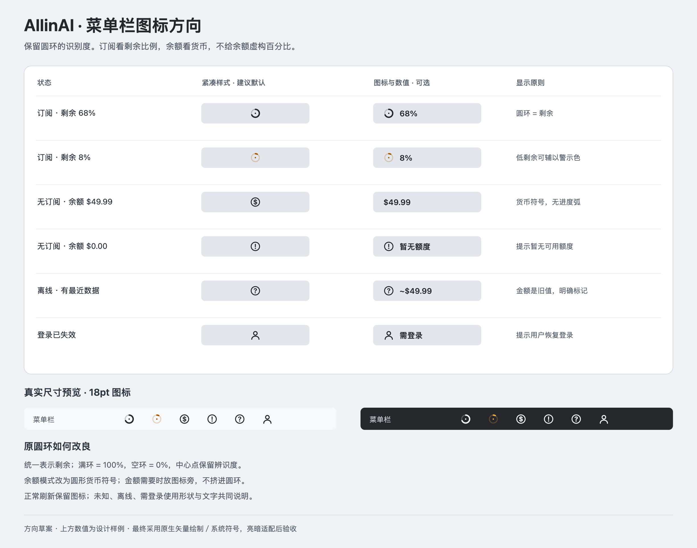
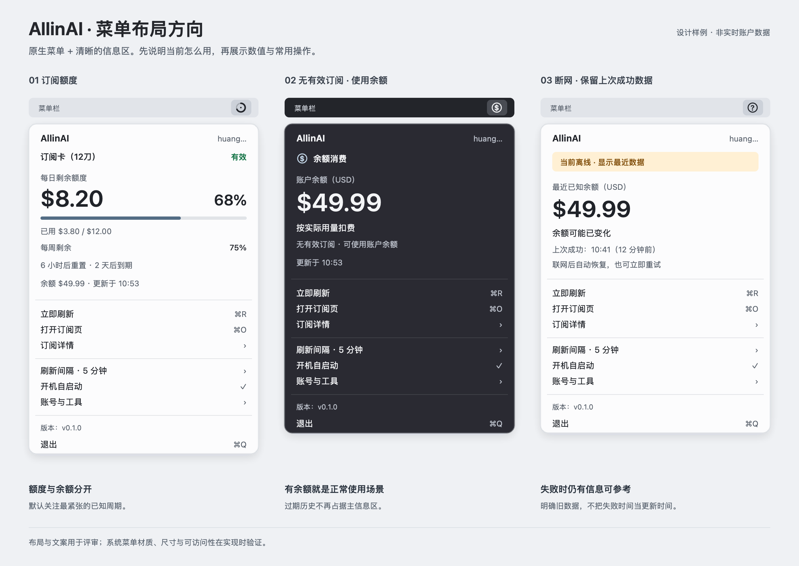
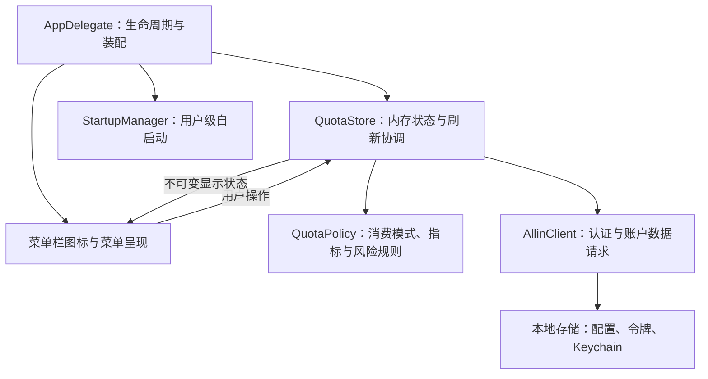

# AllinAI 优化设计方案

2026-10-20 · 设计阶段记录（已确认并实施） · 基于优化前 0.1.0 源码与用户截图

本文保留设计阶段的分析与建议；最终实现见[设计规范](../../DESIGN.md)，实施与验收结果见[验证记录](../verification/2026-10-20.md)。示意图中的金额、百分比与时间是设计样例，不是实时账户信息。

用户已确认：**个人单账号，主要看额度、余额和到期提醒；没有有效订阅时使用余额消费。**

## 1. 建议方向

保留原生菜单栏应用，优先解决“能否用、还能用多少、数据是否可信”，再改善外观。

推荐组合：**自适应菜单栏图标 + 原生菜单中的只读信息区 + 原生操作菜单 + 小范围状态管理整理。**

设计目标是打开后约 3 秒内看懂当前模式、核心数值与风险。这是待验证的目标，不是已测结果。

首版聚焦单账号。多账号管理、历史趋势、消费预测、完整主窗口和跨平台 UI 重写暂缓。

## 2. 现状判断与优先级

已有基础值得保留：原生 AppKit、小体积、Keychain、令牌缓存、异步请求、防止普通重复刷新的 `isFetching`、5 分钟默认刷新与 timer tolerance、用户级自启动。

| 优先级 | 现状与证据 | 用户影响 | 建议 |
| --- | --- | --- | --- |
| P0 | 所有概要数据通过 `disabled()` 输出，设为不可用；源文件 705 行 | 额度和余额比操作按钮更难读 | 只读数据改为自定义信息视图，使用正常的语义文字颜色 |
| P0 | 无订阅显示“没有有效订阅”；有过期记录又会回退选取第一条；528、572 行 | 有余额可消费时仍被“无订阅／过期”主导 | 引入订阅模式、余额模式、暂无可用额度三种业务状态 |
| P0 | `bestMetric` 固定选择第一个正限额；841 行 | 每日宽裕时可能漏掉已接近耗尽的每周额度 | 在已知且有效的周期中选剩余比例最少者，其他周期一并可见 |
| P0 | `loading` 和 `failed` 不保留成功数据；515—557 行 | 每次刷新内容消失，网络波动后无数值可参考 | 保留最后成功快照，刷新状态与数据分开 |
| P0 | 所有订阅请求错误都可能重新登录；188—199 行 | 离线、服务故障也可能引发重复认证 | 分清网络、认证、限流、服务端与协议错误，仅认证失效进入恢复流程 |
| P0 | 没有保存刷新 Task 或会话代次；522、719 行 | 退出后旧请求可能把账户状态甚至令牌写回来 | 取消请求 + 会话代次校验，UI 和令牌落盘两处都校验 |
| P1 | 描述长文本、状态、日期、剩余时间、百分比平铺；618 行 | 菜单被撑宽，主次不清 | 主信息突出，长描述与历史订阅进入详情子菜单 |
| P1 | 余额请求在订阅请求后串行执行，并用 `try?` 隐藏错误；188 行 | 余额异常拖延或表现为笼统“不可用” | 共享有效令牌后独立请求、分别保留结果和成功时间 |
| P1 | 每次读取配置都会进入兼容迁移，当前格式也能被 LegacyConfig 解码；122、325 行 | 打开／重建菜单引发不必要的本地读写 | 迁移仅在启动和确有旧格式时执行，菜单渲染只读内存 |
| P1 | `Keychain.get` 主动激活应用；366 行附近 | 自动认证可能打断前台工作 | 仅用户主动登录或确需交互授权时激活应用；尊重系统钥匙串提示 |
| P1 | `nil` 用量当 0，缺失订阅 data 当空数组；255、841 行 | 数据不完整可能显示为“0%／无订阅” | 区分零值、无上限、未返回和解析失败 |
| P2 | 构建／打包重复生成元数据，安装直接写入目标 app；build.sh、package_dmg.sh | 后续版本容易漂移，失败安装可能残缺 | 小型共享构建入口，先构建成功再替换 app；按分发需求补签名与公证 |

这里的 P0 表示本次优化优先处理，不等同于正式缺陷等级。竞态和焦点影响来自静态代码分析，本轮未在真实账户上复现。

## 3. 先分清订阅与余额两种模式

### 3.1 主状态规则

| 账户情况 | 首要呈现 | 图标语义 | 补充信息 |
| --- | --- | --- | --- |
| 存在可确认有效的订阅 | 订阅额度模式 | 剩余比例圆环 | 余额独立显示，过期时间可见 |
| 没有有效订阅，余额 > 0 | 余额消费模式 | 货币符号或金额 | 过期订阅只在详情保留，不把整个应用标红 |
| 没有有效订阅，余额 ≤ 0 | 暂无可用额度 | 明确的提醒符号 | 同时提供“打开订阅页”，显示实际余额 |
| 没有有效订阅，余额获取失败／未知 | 暂时无法判断可用额度 | 未知状态 | 提供重试，不能把未知当 0 |
| 有效订阅的限制周期已耗尽，余额 > 0 | 订阅额度已用尽 | 额度提醒 | 余额仍独立显示；服务是否自动改扣余额待确认 |
| 有旧数据但本轮断网 | 最近一次数据 + 过时标记 | 数据新鲜度提醒 | 不宣称旧金额是当前可用金额 |

“余额消费”是用户确认的场景；实际某次请求是否会成功、哪些模型可用、是否自动切换扣费仍以服务端为准。UI 不根据余额推算请求次数，不合计订阅美元额度与账户余额。

### 3.2 指标规则

- 订阅圆环、可选数字与 tooltip 全部表示**剩余**，避免一个表示已用、另一个表示剩余。
- 多周期有限额时，默认主指标为剩余比例最低者；例如每日剩余 80%、每周剩余 10%，主区显示“每周剩余 10%”。这表示需关注的约束，不声称已确认服务端调度方式。
- 缺失用量不是 0；缺失限额不是无限；有周期未知时保留可见的未知提醒，不用绿色暗示所有约束都已确认。
- 全部限额明确不适用且服务契约确认无上限时才显示“额度不限”。
- 金额保留两位小数，避免百分比四舍五入到 0% 时暗示已经完全耗尽；小于 1% 但仍大于 0 时显示“<1%”。
- 用量超限时进度条封顶，实际金额照常显示，不把超额使用量改写为上限。
- 有多个订阅时保留全部数据，稳定选取有效订阅；需要切换时使用原生子菜单，不引入多账号管理。不能把不同订阅额度合并成一个百分比。
- 主订阅变化时展示订阅名称；工具不暗示用户的实际请求已经切换到该订阅。

### 3.3 时间规则

现有实现使用 24／168／720 小时；仓库历史网页脚本也使用这些值。**不能据此认定月度必须改成自然月**，先保留已知规则，正式契约确认后再调整。

重置时间优先用服务端明确给出的值；只有窗口起点和规则都可靠时才计算。历史网页对不超过 24 小时的短期订阅还存在“额度结束于订阅到期”的特殊处理，应作为契约核对项。缺少可靠信息时不显示倒计时；已到重置点但刷新失败时显示“等待刷新确认”，不自行把用量清零。

## 4. 菜单栏图标设计

原有 18pt 圆环适合紧凑显示，可以继续用。需要改善的是语义、不同状态的辨识和亮暗背景下的可读性。



### 4.1 推荐：保留圆环，自适应切换模式

| 模式 | 紧凑样式（建议默认） | 数值样式（可选） | tooltip 示例 |
| --- | --- | --- | --- |
| 订阅 | 原圆环，弧长表示剩余 | 圆环 + `68%` | `订阅额度 · 每日剩余 $8.20 / $12.00 · 更新于 10:53` |
| 余额消费 | 等宽圆形货币符号，**没有进度弧** | `$49.99` | `余额消费 · 余额 $49.99 · 更新于 10:53` |
| 暂无可用额度 | 提醒符号 | `暂无额度` | `暂无可用额度 · 无有效订阅，余额 $0.00` |
| 登录失效 | 账户状态符号 | `需登录` | `登录已失效，请重新登录` |
| 首次获取失败 | 问号符号 | `--` | `获取失败，尚无可用数据` |
| 已有缓存、本轮失败 | 未知／过时状态符号 | `~$49.99` / `~68%` | `最近已知余额 $49.99 · 12 分钟前更新 · 当前离线` |

截图中的菜单栏已经较拥挤，因此紧凑样式默认不扩宽；用户在显示偏好中可选“图标和数值”。数值样式仅在用户选择后使用 variableLength，并按当前模式自动选择百分比或余额。

### 4.2 原圆环的具体优化

- 统一 18×18pt 画布、约 14pt 外径，圆角弧线，适配 Retina 像素对齐。
- 100% 为满环，0 为无进度弧；中心增加很小的实心点保持 0% 时可辨识。无上限使用明确的无限符号，不伪造为 100%。
- 常态优先使用能跟随菜单栏背景变化的单色图形；低剩余可辅以橙／红色，但文字、形状和 tooltip 必须共同表达。
- 余额没有“总额”分母，不绘制假进度，也不把某次启动余额当上限。
- 不在 18pt 图标内塞金额、百分比或 S／B 小字；有数值就放图标旁边。
- 状态优先级：需用户重新登录 → 当前无法确认数据 → 暂无可用额度 → 当前消费模式。次要状态留在 tooltip 与菜单信息区。
- 刷新时保留原图标和数值，不每隔几分钟闪成蓝点；仅菜单内显示刷新反馈，不持续旋转。
- 已过期订阅且余额仍可用时，显示余额模式；只有确无可用额度才显示资源不足提醒。
- 余额低提醒使用用户设定的美元阈值；没设阈值时仅在余额 ≤ 0 时提示，不凭空定义“低余额”。

## 5. 菜单布局与交互



图为信息层级示意，不是已运行应用截图。系统材质、菜单圆角和菜单项高度以实际 macOS 为准。

### 5.1 推荐结构：信息区 + 操作区

建议初始内容宽度 352pt；随实际字体与辅助功能需要允许增宽，不用固定高度裁切内容。

1. **顶部身份**：AllinAI 与当前账号；订阅名称或“余额消费”明确可见。
2. **核心数值**：订阅模式突出“每日／每周／每月剩余金额 + 百分比”；余额模式突出“账户余额 $49.99”。
3. **解释信息**：订阅进度条、用量／上限、其他受限周期；余额模式显示“按实际用量扣费”，不伪造百分比。
4. **有效期与新鲜度**：订阅到期与重置明确区分；余额模式以更新时间为主。过期订阅作为次要事实进入详情。
5. **原生操作**：立即刷新、打开订阅页在前；详情、刷新间隔、自启动和账号工具按频率分组。
6. **底部**：保留 `版本：v0.1.0` 与退出。

主菜单建议：

```text
┌───────────────────────────────────┐
│ AllinAI                 当前账号   │
│ 订阅卡（12刀） · 有效               │
│ 每日剩余额度                       │
│ $8.20                        68%  │
│ ━━━━━━━━━━━━━━━━━╺╺╺╺╺╺╺╺        │
│ 已用 $3.80 / $12.00                │
│ 其他周期：每周剩余 75%              │
│ 还有 2 天到期 · 更新于 10:53        │
├───────────────────────────────────┤
│ 立即刷新                       ⌘R │
│ 打开订阅页                     ⌘O │
│ 订阅详情                        › │
├───────────────────────────────────┤
│ 刷新间隔 · 5 分钟                › │
│ ✓ 开机自启动                      │
│ 账号与工具                      › │
├───────────────────────────────────┤
│ 版本：v0.1.0                       │
│ 退出                           ⌘Q │
└───────────────────────────────────┘
```

在余额模式中，整个额度区替换为余额信息，而非在过期订阅下面再增加一行余额。底部“账号与工具”放退出登录、打开配置文件夹，以及显示／提醒偏好；退出登录仍需保留当前已有的确认。

### 5.2 为什么先保留 NSMenu

| 路线 | 收益 | 代价 | 建议 |
| --- | --- | --- | --- |
| 只缩短现有文字 | 修改最少 | 核心数据依然像被禁用，层级改善有限 | 临时修补 |
| NSMenu + 自定义只读信息区 | 清楚展示数值，保留菜单键盘操作与现有结构 | 需要自行处理信息区绘制、尺寸和可访问性 | **首选** |
| NSStatusItem + NSPopover | 更适合复杂筛选、图表和多个交互控件 | 需要处理焦点、关闭、键盘导航与更多布局状态 | 实际功能需要时再考虑 |

AppKit 的 `NSMenuItem.view` 支持自定义内容，并保留菜单项的 key equivalent 和 type-select 机制；自定义信息区的绘制和辅助功能仍需实现并验证。[Apple 文档](https://developer.apple.com/documentation/appkit/nsmenuitem/view)

Apple 的菜单指导建议优先放高频操作、合理分组并控制长度；这也是将退出登录从第一操作移至账号分组的依据。[Apple 菜单设计指南](https://developer.apple.com/design/human-interface-guidelines/menus)

### 5.3 视觉与操作约束

- 使用系统字体；主金额约 26—28pt，正文 12—13pt，辅助文字约 11—12pt，表格数字等宽对齐。
- 核心金额、余额和状态使用正常 labelColor；“只读”不等于低对比度。
- 保持系统菜单材质，服从亮／暗外观、降低透明度、增强对比度设置；不额外叠加玻璃层或背景插图。
- 将普通文字对比度至少 4.5:1 作为可读性评估目标，不能用 disabled 控件的例外来处理核心数据；这是参照 WCAG 的设计目标，并非本轮完成了可访问性认证。[W3C 说明](https://www.w3.org/WAI/WCAG22/Understanding/contrast-minimum.html)
- 长订阅名截断并在详情提供完整内容；服务原始描述不再撑宽主菜单，不能只靠悬停才能读全。
- 所有图标含可访问名称；VoiceOver 可读取完整额度、消费模式、状态与更新时间。
- 原生上下键、Return、Esc 与现有菜单快捷键要继续工作；快捷键仅作用于应用／菜单相应上下文，不注册抢占其他应用的全局热键。
- 菜单正在键盘导航时，不整体 removeAllItems 重建；优先安全更新信息区，动作结构变化可等下次打开再应用。

## 6. 异常、首次使用与提醒

| 情况 | 反馈与恢复 |
| --- | --- |
| 未登录 | 简短说明用途和本地存储方式，主操作“登录…” |
| 首次加载 | 显示占位信息，不显示 $0.00 或 0% 冒充结果 |
| 正常后台刷新 | 保留数据，菜单内显示“正在刷新…”；合并重复请求 |
| 余额成功、订阅失败 | 若无可靠订阅结论，注明“订阅状态暂不可用”；保留可确认的余额，不武断切换消费模式 |
| 订阅成功、余额失败 | 继续展示订阅额度；余额显示最近已知值或“暂不可用”，注明独立更新时间 |
| 刷新失败 | 保留最近成功数据，明确“12 分钟前更新”；失败时间不能冒充成功更新时间 |
| 登录失效 | 显示“登录已失效，请重新登录”；不连续弹窗，不无限重试密码 |
| 无有效订阅但余额充足 | 正常余额模式；过期详情不压过当前可用余额 |
| 余额不足或订阅用尽 | 明确原因，给出打开订阅页的入口，不把资源不足写成网络故障 |
| 返回未知状态／字段缺失 | 显示“状态暂不可确认”，在详情保留必要诊断，不显示原始敏感响应 |

登录按钮由“保存”改为“登录”；输入错误在表单内反馈，保留已输入邮箱。先验证成功，再保存正式账户会话；系统钥匙串权限取消应能重试。密码继续只进 Keychain。

提醒作为可选功能：用户主动开启时才申请通知权限。首版可提供到期前 3 天／1 天、订阅剩余 10%、用户自设低余额阈值。按账号、订阅、窗口、阈值去重；离线、旧数据、启动恢复时不连发历史提醒；余额消费模式不被已过期的历史订阅反复提醒。具体开启项和阈值仍可在实施前收敛。

## 7. 架构优化：先整理职责，再决定是否拆文件

约 986 行单文件对当前规模并非原罪；真正问题是账户状态、刷新、规则、渲染和持久化紧密相连。先用少量明确模块降低耦合，不引入通用框架。



| 模块 | 小而清晰的 interface | 隐藏在内部的 implementation |
| --- | --- | --- |
| QuotaStore | 查看状态、刷新、登录、退出 | 单个刷新任务、会话代次、成功快照、局部失败、刷新调度 |
| QuotaPolicy | 原始数据 + 当前时间 → 显示状态 | 消费模式、订阅选择、周期比较、有效期和未知值处理 |
| AllinClient | 登录／结束会话、获取账户数据 | HTTP 与业务错误分类、令牌刷新合并、有限重试 |
| 本地存储 | 加载／保存／清理 | 旧格式一次性迁移、原子写入、文件权限、Keychain 错误 |
| 菜单呈现 | 显示状态与处理用户意图 | 字体、间距、图标、菜单项更新；不读文件或直接查询 Keychain |

状态上分开保存：当前账户会话、最后成功快照、订阅与余额各自的新鲜度、刷新进度、最近失败。UI 状态由这些事实推导，不再仅靠一个互斥的 loading／loaded／failed 枚举。

重要实现约束：

- UI 状态集中在 MainActor；网络与令牌共享状态串行化，获取有效 token 的过程只运行一份。
- 认证恢复只在已确认的认证错误发生；普通超时、离线、429、5xx 不触发重新登录；认证恢复最多重放一次原请求。
- 订阅与 profile 共用认证结果后可并发，但不能使用并发请求引发重复刷新 token；资源结果独立更新。
- 退出登录要先结束会话、取消请求，再清理状态与令牌；旧会话无权回写文件或 UI。
- 取消是协作式的，单独 `Task.cancel()` 不够，需在响应处理和持久化前检查会话代次。[Apple Task 取消说明](https://developer.apple.com/documentation/swift/task/cancel())
- 菜单打开只渲染内存；配置校验、迁移和 Keychain 访问移出渲染路径。
- 明确处理 Keychain 写入失败，不用“先删再添加”轻易丢失原凭据；设置保存失败不能静默忽略。
- 令牌文件明确限制为当前用户读写，目录同样收紧；原子替换后检查权限。日志不写密码、Authorization、令牌或完整响应。
- 首版只需内存快照；若后续需要重启即显示旧数据，再增加按账号隔离、退出清理且明确过时的本地快照。

这些模块可以先留在单文件中。若实现新信息区后确需拆分，再控制在约 5—6 个文件；用实际责任划分，不为每个模型建一层。多文件构建时同步调整两个构建入口，并处理 Swift 顶层入口为 main.swift 或单一 @main，不能只拆文件不改编译方式。

## 8. 刷新、资源占用与发布

- 默认继续 5 分钟，保留 1／5／10／30 分钟选项；不因新 UI 引入每秒网络请求。
- 打开菜单时，只有超过所选刷新间隔且无进行中请求才补刷新；重复打开不连续发请求。
- 失败使用有上限的退避，例如所选间隔的 1／2／4 倍，上限 30 分钟；429 尊重服务端 Retry-After。手动刷新可立即尝试，但仍合并进行中请求。
- 睡眠停止无意义工作，唤醒或恢复网络后合并为一次刷新，避免补发全部错过的 timer。
- 倒计时仅菜单可见时按需更新，本地计算不能替代服务端用量刷新。
- 先解决渲染时本地 I/O、重复认证和焦点打断，再用 Instruments 测量耗时和唤醒，不预先承诺内存或耗电降幅。
- 保留用户级 LaunchAgent；读取到损坏 plist 不应直接显示“已开启”。自启动状态需要能反映真实配置并给出恢复方式。
- 抽取小型共享编译／Info.plist 生成流程，安装与 DMG 打包都调用；先在临时目录完成构建，验证后替换安装目标。
- 版本实际发布时同时更新 build.sh、package_dmg.sh 与源码 fallback；本设计阶段保持 0.1.0。
- 若有对外广泛分发需求，再规划 Apple Silicon／Intel 支持、签名、公证和更新检查；不默认引入完整自动更新依赖。

## 9. 实施顺序与验收

| 阶段 | 范围 | 完成标准 |
| --- | --- | --- |
| 第一阶段：事实正确 | 消费模式、所有周期判断、未知数据、保留成功快照、认证错误分类、退出竞态 | 余额账户不再被过期订阅误判；失败不会假装余额为 0；退出后无旧会话回写 |
| 第二阶段：看得清楚 | 原生信息区、改良圆环、余额图标、可选数字、菜单重排与详细状态 | 亮暗模式可读；主信息无需翻子菜单；信息、图标与 tooltip 语义一致 |
| 第三阶段：日常可靠 | 可选提醒、唤醒与退避、配置迁移、发布脚本整理 | 提醒去重、权限失败可恢复；构建与打包结果一致 |

建议首轮范围覆盖第一、第二阶段；第三阶段拆成独立的小改动，避免 UI 更新同时扩张为完整平台改造。

实施后的关键验证：

1. 无有效订阅且余额 $49.99 → 余额消费；存在过期历史记录也得到相同主状态。
2. 无有效订阅且余额 0／未知 → 分别是余额不足／未知，不能混同。
3. 每日剩余 80%、每周剩余 10% → 主指标选每周，日额度仍可见。
4. 有效订阅耗尽且余额 > 0 → 不擅自承诺自动切换扣费。
5. 超时或服务故障 → 不发登录请求，成功快照仍在，更新时间真实。
6. profile 单独失败 → 订阅可用；订阅单独失败 → 不从余额推断不存在订阅。
7. 退出与请求完成并发 → 旧状态和旧 token 均不能恢复；再登录不被旧请求覆盖。
8. 0／nil／超限／无限、边界小数、跨时区、短期订阅、窗口已到但网络失败都符合规则。
9. 两种消费模式与主要异常状态在亮暗外观、增强对比度、降低透明度、VoiceOver、键盘操作下可使用。
10. 配置迁移只执行一次；钥匙串取消与保存失败可恢复；通知拒绝后仍可正常使用应用。

对纯规则、错误恢复和账户竞态编写有价值的测试；布局使用状态样例人工验收。源代码／脚本变更后运行仓库要求的 Swift typecheck 与三个 zsh 语法检查；安装、DMG 与版本检查随相应改动执行。

## 10. 本轮结论与待定项

推荐保留原来的圆环作为订阅模式图标，增加余额模式的货币图标；默认紧凑，金额／百分比按用户选择显示。主菜单采用原生信息区，消费模式优先于过期历史，数据可信度优先于装饰。

实施前还需要收敛三项：是否采用这版信息布局；是否默认开启图标旁数值（本方案建议关闭）；提醒首版覆盖哪些阈值。服务端“订阅用尽自动扣余额”与窗口契约需核实后才能进一步承诺。
