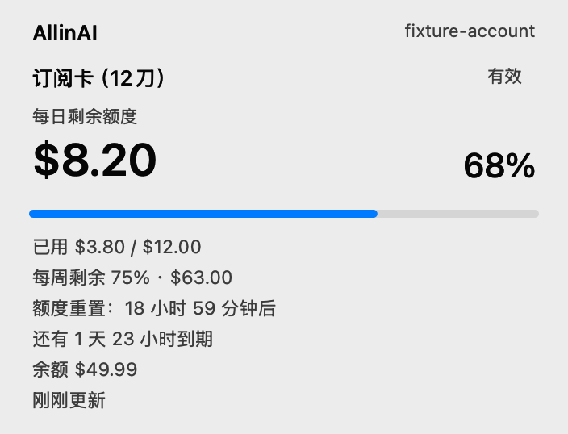
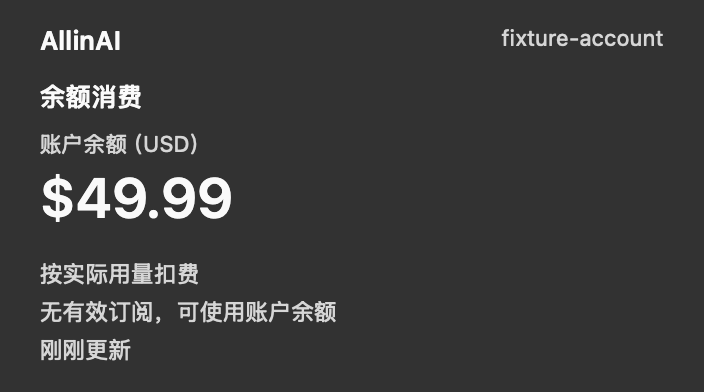
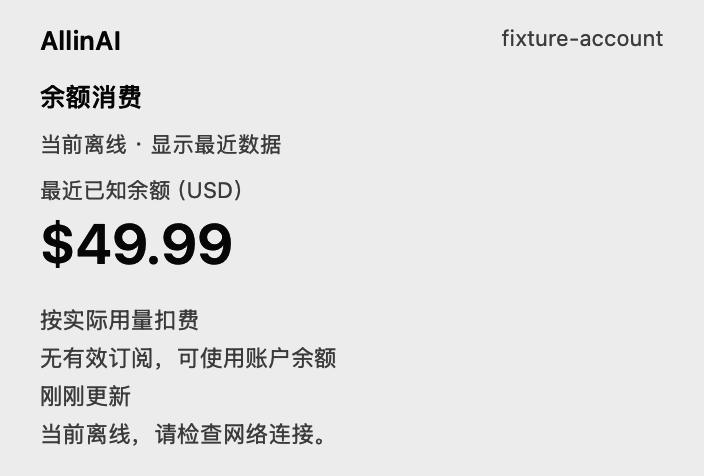
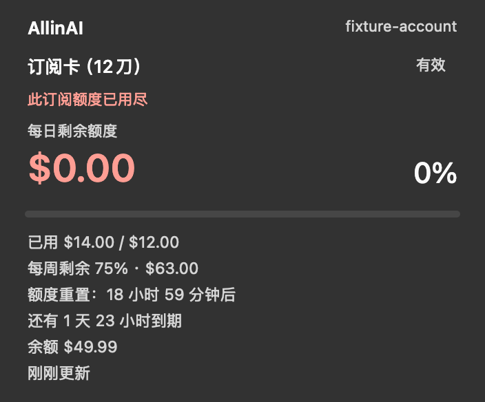

# AllinAI Quota 实施与验证记录

日期：2026-10-20。版本：0.1.0，构建号：1。

本记录保留当时界面优化的验证证据；后续新增更新检查并升级到 v0.2.0 的结果见[发布验证记录](release-0.2.0.md)。下方测试数量、版本及镜像校验值仅对应当时产物。

验收结论：自动测试与构建校验通过；用户在完成本轮菜单操作检查后确认“功能没问题”。本轮核心功能验收完成。

## 已实施

- 保留单文件 Swift、原生 AppKit、菜单栏常驻与现有服务地址；数据获取、状态决策、提醒和界面在文件内分层。
- 有效订阅突出剩余额度、剩余比例、受限周期与有效期；无有效订阅且有余额时切换为余额消费模式，过期订阅保留在详情中。
- 菜单栏默认仅显示模板图标：订阅为剩余圆环，余额为货币符号，未知、不可用和账号状态有独立符号。数值显示可在“账号与工具”中开启。
- 用正常文字颜色的只读概览替代禁用菜单项；操作保持原生菜单行为，长说明移入详情。
- 刷新期间与请求失败后保留最近成功数据，独立记录订阅与余额的更新时间。未知数据不当作零，订阅额度耗尽不推断服务会自动扣余额。
- 客户端采用 actor、会话代次和合并令牌续期；认证恢复只处理认证错误，局部失败保留另一资源的成功结果。
- 加入合理轮询、睡眠暂停、唤醒和网络恢复合并、失败退避与服务端限流冷却。手动刷新同样尊重限流期限。
- 可选到期、低额度、低余额提醒默认关闭；显式开启后申请系统通知权限，并按账号、订阅和周期去重。
- 构建先生成并验证完整 bundle，再替换目标；替换失败恢复旧应用。DMG 使用相同构建入口，成功后才替换旧安装包。

## 自动与构建验证

以下检查均已通过：

```sh
swiftc -typecheck Sources/AllinAIQuotaMenu.swift
swiftc -swift-version 6 -typecheck Sources/AllinAIQuotaMenu.swift
zsh -n build.sh
zsh -n make_icon.sh
zsh -n package_dmg.sh
zsh -n Tests/run_tests.sh
./Tests/run_tests.sh
./build.sh
./package_dmg.sh
hdiutil imageinfo dist/AllinAI-Quota.dmg
hdiutil verify dist/AllinAI-Quota.dmg
git diff --check
```

测试结果：**25/25 通过**。使用隔离的 URLProtocol、临时目录、随机测试凭据和内存凭据存储，不读取真实 Keychain、不请求真实服务。覆盖模式判断、限额缺失、最受限周期、局部失败、认证重试与合并续期、退出后的迟到结果、限流冷却、提醒、亮暗警示色对比度及本地文件权限。独立复查同样通过测试与 Swift 6 类型检查；发现的四项问题已修复并补充回归覆盖。

构建失败与替换失败另做了隔离故障注入：模拟编译器失败后旧 bundle 保持完整；模拟安装移动失败后旧 bundle 自动恢复，两种情况的临时目录均清理完成。故障注入使用临时目标，不影响已安装应用。

已检查安装目录中的 Info.plist：版本 0.1.0、构建号 1、`LSUIElement = true`。新版已安装到 `/Applications/AllinAI Quota.app` 并重启，进程已确认运行。

DMG 输出：`dist/AllinAI-Quota.dmg`，UDZO 压缩只读镜像；镜像校验成功，CRC32 为 `E42E3032`。打包暂存目录已清理。

## 原生视图预览

以下图像由生产代码的 AppKit 视图直接渲染，**数据均为模拟值**。它们用于检查布局、文案、颜色和状态，不是已登录账户的实际菜单截图。

```sh
./Tests/run_tests.sh --render-previews "$PWD/.build/previews"
```

已生成并检查订阅、余额、离线、额度耗尽、未知、未登录六种状态的亮暗版本，以及两套菜单栏图标。保留以下代表性证据：

| 订阅 · 浅色 | 余额 · 深色 |
| --- | --- |
|  |  |

| 离线 · 浅色 | 额度耗尽 · 深色 |
| --- | --- |
|  |  |

菜单栏图标样例：


## 用户截图核对

用户于 2026-10-20 手动展开已安装应用并提供实际深色菜单截图。已确认：菜单栏显示货币圆形图标；概览显示“余额消费”、独立账户余额及无有效订阅的说明；主要金额使用正常高对比文字；操作区、子菜单入口、5 分钟刷新间隔及底部版本正常呈现。截图范围内未见文字溢出、截断或布局错位。此截图为用户本地账户界面，未纳入版本库。

用户随后补充账号与工具子菜单、菜单栏数值开启后的两张实机截图，并确认“功能没问题”。截图可直接核对：

- “账号与工具”子菜单正常展开，包含重新登录、退出登录、数值显示、提醒设置及配置文件夹入口。
- 开启数值后，菜单栏显示账户金额，并隐藏重复的货币图标。
- 手动刷新后的概览显示“刚刚更新”，信息区与操作区布局保持正常。

针对此前请求的子菜单、数值切换、手动刷新及 Esc 关闭检查，用户已给出功能无问题的实机确认。该结论来自用户操作与截图，不是自动化执行结果；登录退出、通知送达等操作不包含在本次确认中。

## 验证方式与边界

第一次桌面验证因 Mac 锁屏而中止。用户确认解锁后已继续：桌面清单、Finder 无障碍树与窗口截图均可读取，但使用应用路径或 bundle identifier 连接 AllinAI 均返回 `timeoutReached`，连接 SystemUIServer 也超时。一次 1 秒进程采样显示应用主线程在正常 AppKit 事件循环中等待事件，没有发现主线程阻塞证据。用户手动展开 AllinAI 菜单后，自动化连接仍然超时，现改由用户截图核对实际界面。

核心菜单检查已改由用户实机操作完成；桌面自动化无法连接菜单栏应用的限制仍存在。菜单快捷键未逐项实测，用户截图也不验证服务端金额的正确性。

VoiceOver 阅读顺序、系统高对比度／减少透明度设置及真实通知授权和送达未做实机验收；通知保持默认关闭。测试不替代真实服务的端到端验证。

服务在有效订阅额度耗尽后是否自动扣余额、缺失限额与重置窗口的正式契约仍未确认，因此界面保守展示已有数据和不确定状态。
